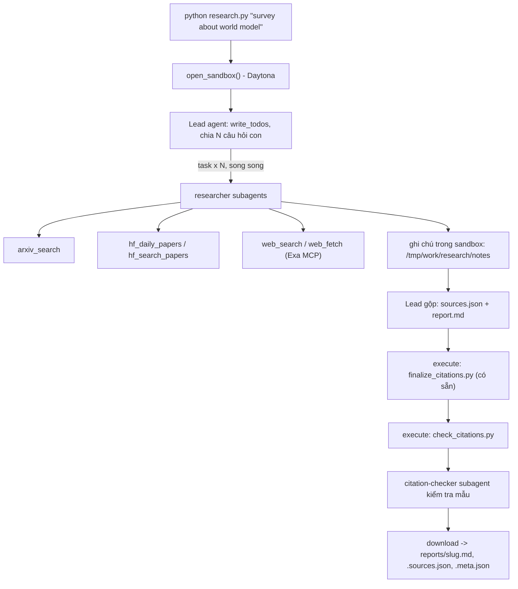

# Deep Research Agent (Deep Agents + Sandbox)

Lab dựng một **hệ thống deep research đa tác tử**: người dùng chỉ cần nhập một chủ đề (ví dụ `survey about world model`), hệ thống tự lập kế hoạch, giao việc cho nhiều subagent, tìm tài liệu trên arXiv, Hugging Face và web, rồi viết một **báo cáo có trích dẫn**.

Hình thức: **bài thực hành cá nhân**. Ngôn ngữ lập trình: Python 3.11 trở lên.

## 1. Mục tiêu học tập

Sau lab, bạn có thể:

1. Dựng agent bằng thư viện Deep Agents (LangChain): công cụ (tool), system prompt, subagent, backend.
2. Dùng **sandbox** (Daytona) làm không gian làm việc và nơi chạy mã cho agent; hiểu vì sao khóa API và công cụ mạng phải nằm ở phía host chứ không nằm trong sandbox.
3. Viết công cụ gọi API ngoài **chịu được giới hạn tốc độ** (retry, backoff, jitter, `Retry-After`).
4. Thiết kế quy trình đa tác tử: lead chia nhỏ câu hỏi, giao cho N researcher chạy song song, tổng hợp và kiểm tra trích dẫn.
5. Tạo báo cáo có thể kiểm chứng: mọi khẳng định có `[n]` trỏ tới một nguồn có thật.

## 2. Hệ thống làm gì



Nguồn dữ liệu:

| Nguồn | Dùng để |
|---|---|
| arXiv API `https://export.arxiv.org/api/query` | Tìm bài theo từ khóa, sắp theo ngày |
| Hugging Face Daily Papers `/api/daily_papers` | Bài đang "trending": upvotes, githubRepo, summary |
| Hugging Face papers search `/api/papers/search?q=` | Tìm bài theo chủ đề |
| Web qua Exa MCP (`web_search_exa`, `web_fetch_exa`) | Blog, survey, trang dự án, nội dung đầy đủ của một URL |

## 3. Cấu trúc thư mục

```
Lab/
├── README.md  GUIDE.md  RUBRIC.md  REPORT_TEMPLATE.md   tài liệu
├── topics.md                 5 chủ đề cần chạy
├── requirements.txt  .env.example  .gitignore
├── model.py                  CÓ SẴN - không sửa: tạo mô hình LLM từ biến môi trường
├── sandbox.py                CÓ SẴN - không sửa: sandbox Daytona (hoặc Docker), upload, download
├── self_check.py             CÓ SẴN - không sửa: tự kiểm tra trước khi nộp (python self_check.py)
├── finalize_citations.py     CÓ SẴN - không sửa: script chạy trong sandbox, tự sinh `## References` và đánh số lại trích dẫn
├── tools.py                  SINH VIÊN CÀI ĐẶT: retry + 5 công cụ nguồn dữ liệu
├── agents.py                 SINH VIÊN CÀI ĐẶT: prompt, subagent, lead agent
├── research.py               SINH VIÊN CÀI ĐẶT: script chính
├── check_citations.py        SINH VIÊN CÀI ĐẶT: kiểm tra trích dẫn, chạy TRONG sandbox
└── reports/                  báo cáo sinh ra (bạn commit vào repo nộp)
```

Bản khung ban đầu của mỗi tệp "SINH VIÊN CÀI ĐẶT" là **pseudo-code chạy được** (import được): các hàm có docstring mô tả việc cần làm và `TODO n` khớp với `GUIDE.md`. Trong bản triển khai này, bốn tệp đã được hoàn thiện; kiểm thử nằm trong `tests/`.

## 4. Cài đặt

```bash
python3 -m venv .venv && source .venv/bin/activate      # Python 3.11+
pip install -r requirements.txt
cp .env.example .env                                     # rồi điền khóa CỦA BẠN
```

Trên Windows/PowerShell:

```powershell
python -m venv .venv
.\.venv\Scripts\python.exe -m pip install -r requirements.txt
Copy-Item .env.example .env
# Điền cấu hình và khóa trong .env, rồi chạy:
.\.venv\Scripts\python.exe research.py "survey about world model"
```

Mô hình dùng trong các lần chạy nộp bài được ghi riêng ở từng `.meta.json`. Đặt `LAB_MODEL` theo nhà cung cấp của bạn; mô hình phải hỗ trợ tool calling và tài khoản phải còn hạn mức.

Bạn cần ba loại khóa (điền vào `.env`, **không bao giờ commit** `.env`):

| Khóa | Lấy ở đâu | Ghi chú |
|---|---|---|
| LLM (`LAB_MODEL` + khóa nhà cung cấp) | Nhà cung cấp bạn chọn (OpenAI, Anthropic, Google, OpenRouter, Ollama...) | Mô hình **phải hỗ trợ tool calling**. Chép tên mô hình từ tài liệu của nhà cung cấp. |
| `DAYTONA_API_KEY` | https://app.daytona.io | Kiểm tra gói miễn phí / credit hiện hành. Không có tài khoản hoặc hết credit: đặt `SANDBOX=docker` để chạy sandbox trong container Docker cục bộ (xem `.env.example`). |
| `EXA_API_KEY` (khuyến nghị) | https://dashboard.exa.ai/api-keys | Có thể chạy không khóa, nhưng bản miễn phí của MCP bị giới hạn tốc độ rất nhanh. |

## 5. Làm bài

Làm theo thứ tự (chi tiết trong `GUIDE.md`):

1. `check_citations.py`: khởi động nhẹ, thuần Python.
2. `tools.py`: viết `with_retry` và 5 công cụ. Thử riêng từng công cụ: `python tools.py`.
3. `agents.py`: viết prompt, subagent và lead agent.
4. `research.py`: ghép tất cả; chạy một chủ đề:

```bash
python research.py "survey about world model"
```

Kết quả nằm ở `reports/survey-about-world-model.md` cùng `.sources.json` và `.meta.json`.

## 6. Chủ đề và nộp bài

- Chạy đủ **5 chủ đề** trong [`topics.md`](topics.md), mỗi chủ đề một lần.
- Commit mã nguồn và toàn bộ `reports/`, đẩy lên một **public repo** GitHub và nộp link.
- Kiểm tra trước khi nộp: chạy **`python self_check.py`** (không tốn token): nó kiểm tra đủ 5 báo cáo, `meta.json`, trích dẫn bằng `check_citations.py` của bạn, và không có `.env`/khóa nào trong git.
- Cách chấm: xem [`RUBRIC.md`](RUBRIC.md).

## 7. Thời gian, chi phí và an toàn

- Dùng một mô hình **rẻ nhưng hỗ trợ tool calling**, và **đặt giới hạn** (số lần gọi mô hình/công cụ cho lead và subagent, `recursion_limit`): một prompt hỏng có thể khiến agent lặp rất lâu. Đây là hạng mục 2.5 của `RUBRIC.md`.
- Kết quả có tính ngẫu nhiên: cùng một mã có thể cho báo cáo hợp lệ ở lần này và trích dẫn lỗi ở lần sau. Hãy sửa **prompt và mã**, không sửa tay báo cáo.

- Mỗi lần chạy tốn token LLM và thời gian sandbox. `tokens` trong `meta.json` chỉ đếm tin nhắn của lead, chưa gồm subagent, nên chi phí thật cao hơn. `open_sandbox()` luôn dừng và xóa sandbox khi kết thúc, kể cả khi lỗi. Đừng bỏ qua nó.
- **Không đưa bí mật vào sandbox.** Sandbox không ngăn được prompt injection hay việc đẩy dữ liệu ra mạng; một trang web độc hại có thể khiến agent chạy lệnh bên trong sandbox. Vì vậy mọi công cụ gọi mạng và mọi khóa ở lại phía host.
- Nội dung lấy từ web là **dữ liệu không đáng tin**: agent không được làm theo chỉ dẫn nằm trong đó.

## 8. Đọc kết quả và kiểm thử bản triển khai

Cách đọc mã theo thứ tự bài học:

1. `check_citations.py`: kiểm tra quan hệ giữa `[n]`, nguồn JSON và một dòng tham khảo có đúng URL. Đây là kiểm tra cấu trúc; nó không tự chứng minh câu khoa học đúng.
2. `tools.py`: bọc các API thành công cụ trả chuỗi, chỉ retry lỗi tạm thời, che khóa và điều tiết arXiv. Các công cụ chạy trên host để khóa không vào sandbox.
3. `agents.py`: lead lập kế hoạch và giao ít nhất ba câu hỏi độc lập cho researcher; checker chỉ có `web_fetch` để đối chiếu nguồn. Middleware giới hạn số lời gọi; checkpoint giữ lịch sử và bộ đếm khi sửa lỗi.
4. `research.py`: tạo sandbox, tải validator lên, gọi agent, kiểm tra kết quả và tải nguyên bản về. Khi lỗi, báo cáo hợp lệ trước đó được giữ và sandbox vẫn được dọn dẹp.

Finalizer sửa số và định dạng tham khảo, validator tìm lỗi cấu trúc, còn checker đối chiếu ý nghĩa. Cần cả ba: một số `[7]` tồn tại vẫn có thể dẫn nhầm bài báo.

Bản tiết kiệm dùng ba researcher, mục tiêu 6–9 nguồn và nén lịch sử ở khoảng 24.000 token, giữ sáu tin nhắn gần nhất; bằng chứng vẫn nằm trong tệp sandbox. Lịch sử nén được lưu dưới `/tmp/work/conversation_history/`. Mô hình được chọn bằng `LAB_MODEL`; `LAB_RESEARCH_MODEL` và `LAB_SUMMARY_MODEL` cho phép dùng mô hình nhỏ riêng cho tìm nguồn và nén. Cấu hình cục bộ hiện dùng `gpt-4.1-mini` cho tất cả vai trò; các lượt trước đã dùng cả `gpt-4.1`, được ghi riêng trong metadata.

`LAB_MAX_TOTAL_TOKENS` mặc định 250000 đặt ngân sách dùng chung cho lead, subagent và bước nén. Callback ghi usage thực vào `current_run_usage`, gồm lượt gọi thành công của toàn bộ agent trong lần chạy hiện tại. Ngân sách xét đầu vào ước lượng và dự trữ đầu ra trước lời gọi; đây là cơ chế giới hạn token, không phải hạn mức thanh toán cứng của nhà cung cấp. Metadata cũ chỉ có token lead nên không thể dùng để so sánh tổng chi phí chính xác.

Biến `LAB_MAX_TOTAL_TOKENS` trong `.env` hiện được đặt thành 140000 để giảm chi phí; các lượt trước đã dùng 400000. Nếu nhà cung cấp không trả usage, hệ thống dừng thay vì xem lời gọi là miễn phí. Khi một lượt thất bại, ghi chú/bản nháp được giữ trong `development/checkpoints/` sau kiểm tra khóa; chạy lại cùng chủ đề sẽ tải chúng lên sandbox và tiếp tục. Checkpoint không nằm trong bài nộp, và số lời gọi cũ được cộng từ metadata thực tế.

Mỗi chủ đề có ba tệp trong `reports/`:

- `<slug>.md`: báo cáo tiếng Anh, tổng hợp theo chủ đề và trích dẫn `[n]`.
- `<slug>.sources.json`: nguồn với số `n`, ID, URL, tiêu đề, ngày và nhãn công cụ nguồn.
- `<slug>.meta.json`: chủ đề, mô hình, thời gian, lời gọi công cụ/subagent, token của lead, số nguồn và các nhãn nguồn.

Metadata còn chứa `citation_audit`: verdict và lý do cho tối đa năm mẫu nguồn/khẳng định, rải đều trên danh sách nguồn cuối. Đây là kiểm tra mẫu theo `GUIDE.md`/`RUBRIC.md`, không phải chứng minh toàn bộ nội dung. Validator vẫn kiểm tra tất cả số trích dẫn, URL và cấu trúc. `audit_scope` và `n_audited_sources` ghi rõ phạm vi kiểm tra.

Controller tách `DRAFT_PHASE` và `AUDIT_PHASE` thành hai graph có lịch sử riêng: audit không phải nhận lại lịch sử soạn bài. Sau khi agent viết/sửa thân bài, mã tất định trong sandbox chuẩn hóa ID bị ghi thành URL và cách viết hoa các tiêu đề cố định, rồi chạy finalizer/validator trước khi giao checker. Nhờ vậy checker đọc mapping cuối thay vì số cũ. Checker chỉ có `audit_prepare`, `web_fetch`, `audit_record`, giúp giảm công cụ và tránh sửa nhầm báo cáo. Ngân sách token vẫn dùng chung cho cả hai pha, và metadata cộng các lời gọi thực. Lead sửa lỗi nội dung trong sandbox, rồi lặp hai pha khi cần. Báo cáo và JSON nguồn được giữ nguyên bytes tải về sau khi đạt kiểm tra. Audit LLM hỗ trợ kiểm tra; các phần thủ công của `RUBRIC.md` vẫn do người chấm đánh giá.

Audit còn ghi `claim` (câu nguyên văn trong báo cáo), `evidence` (tối đa 10 từ nguyên văn từ `web_fetch`) và hash nội dung đã tải. Host đối chiếu cả hai câu với báo cáo và nội dung nguồn thực sự tải trong tiến trình.

Hai công cụ nội bộ `audit_prepare`/`audit_record` tạo và cập nhật các trường cơ học trong sandbox; checker phán đoán mức hỗ trợ về nội dung. `audit_record` có thể tự chọn một trích đoạn nguyên văn ngắn từ trang đã tải để ghi dấu bằng chứng. Trích đoạn này không chứng minh tất cả các ý: verdict phải xét toàn bộ nội dung nguồn đã tải. Mọi lệnh của agent đóng stdin và bị giới hạn 120 giây để tránh chờ đầu vào vô hạn.

Nếu review phát hiện lỗi ở báo cáo đã có, chạy một lượt sửa trong sandbox:

```powershell
.\.venv\Scripts\python.exe research.py --repair-existing "survey about world model"
```

Lượt sửa giữ nội dung đúng và chỉ nghiên cứu thêm khi thiếu bằng chứng. `phases` trong metadata ghi riêng lần sinh và lần review; tổng số liệu lấy từ lời gọi thực tế. Báo cáo cũ được giữ nếu lượt sửa thất bại.

Kiểm thử tự động dùng thư viện chuẩn `unittest`:

```powershell
.\.venv\Scripts\python.exe -m unittest discover -s tests -v
.\.venv\Scripts\python.exe self_check.py
```

Smoke test sandbox thật được bật riêng, cần Daytona hoặc Docker nhưng không gọi LLM:

```powershell
$env:LAB_RUN_SANDBOX_TEST = '1'
.\.venv\Scripts\python.exe -m unittest discover -s tests -p test_sandbox.py -v
Remove-Item Env:LAB_RUN_SANDBOX_TEST
```

`development/` chứa bản thử nghiệm bị review từ chối, được Git bỏ qua. Các tệp CÓ SẴN được giữ nguyên. Bài nộp gồm mã triển khai, tài liệu, kiểm thử và các bộ kết quả trong `reports/`.

Không chạy lại cả năm chủ đề nếu báo cáo đã đạt; `self_check.py` và unit tests không gọi LLM. Chỉ chuyển lên mô hình lớn khi một lỗi cụ thể cần xử lý. Trần token là kiểm soát gần đúng trước mỗi lời gọi, không phải trần hóa đơn; phí công cụ tìm kiếm và sandbox tính riêng.

Khi sinh báo cáo mới, `save_retrieved_sources` ghi ID, tiêu đề, ngày và nhãn nguồn từ bản ghi thật của công cụ. Host đối chiếu metadata cả trước audit và trước khi lưu kết quả cuối, tránh việc model đoán ID hoặc đổi nhãn nguồn. Các lượt sửa báo cáo cũ giữ nguồn hiện có và kiểm tra mẫu nội dung.
